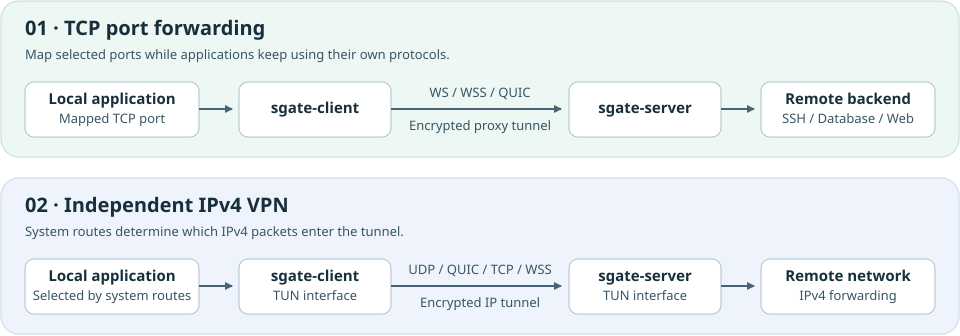
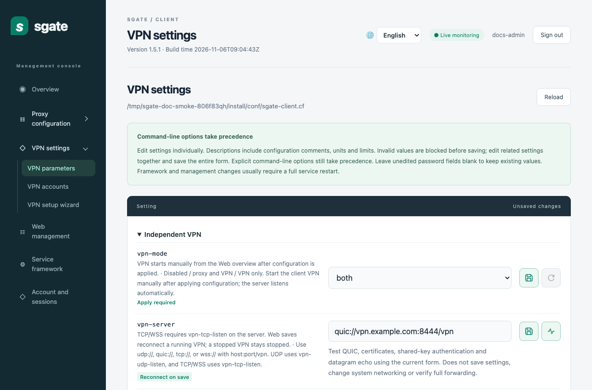
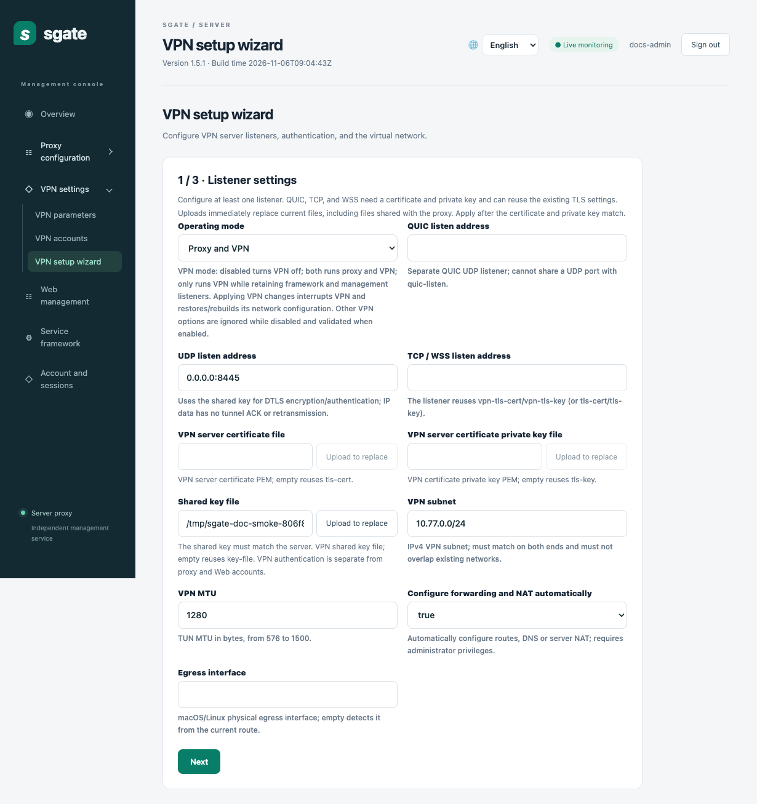
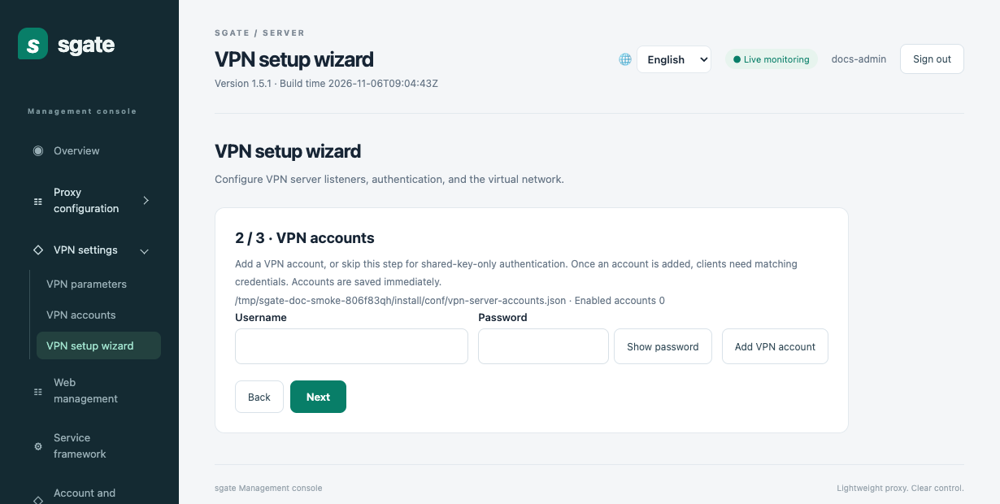
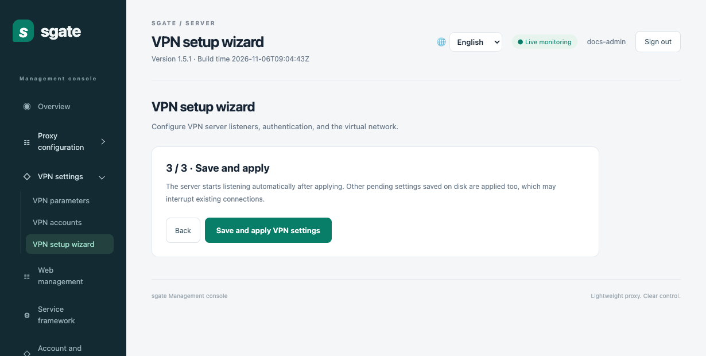
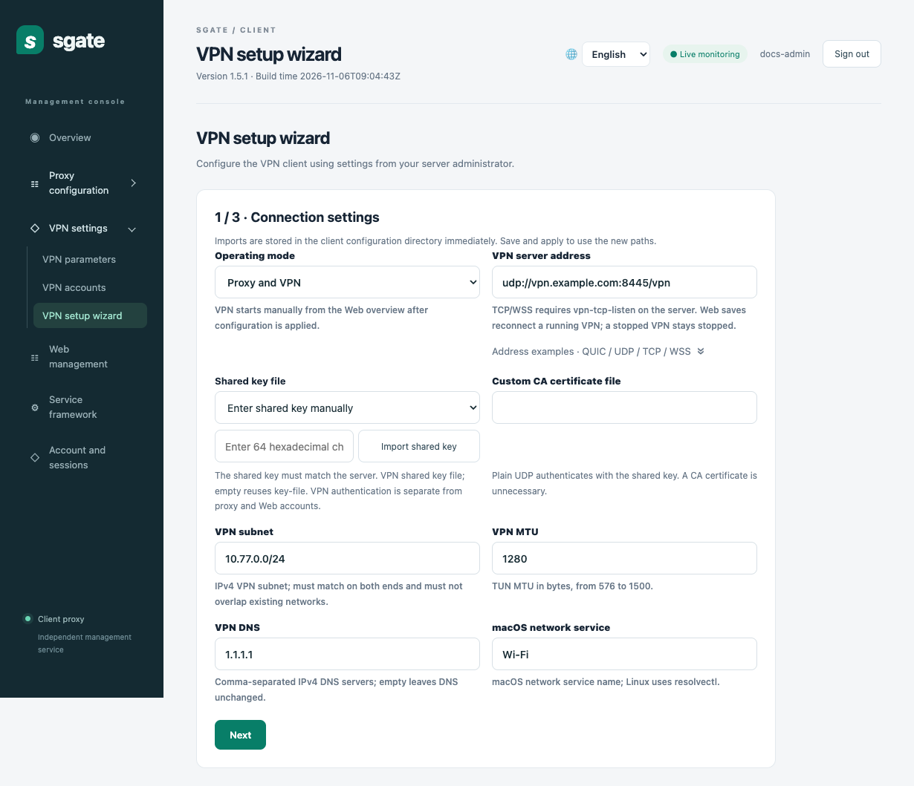
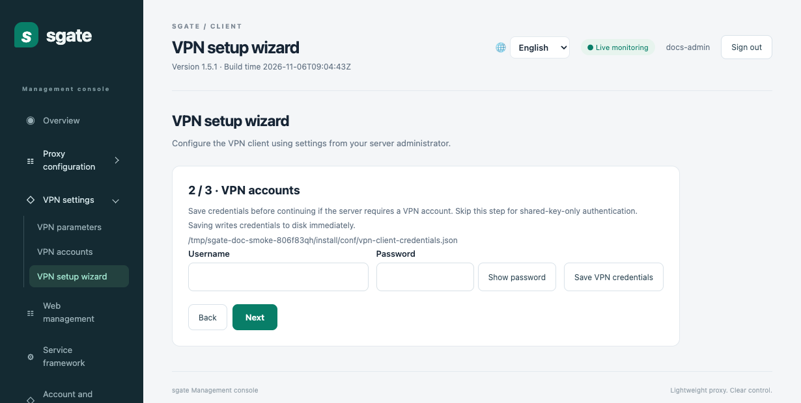
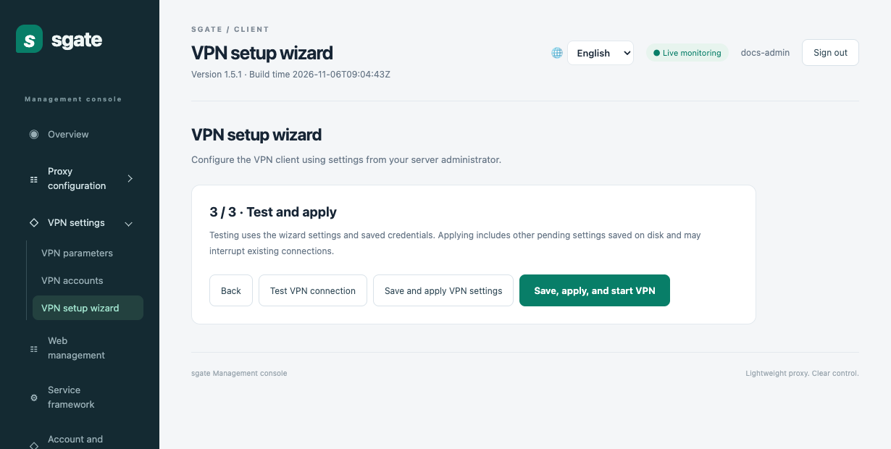

# sgate

**Encrypted TCP port forwarding and an independent IPv4 VPN**

Version `1.5.2` · [简体中文](README.md)

Use sgate to reach selected TCP services such as SSH, databases, and internal web apps, or enable the IPv4 VPN to route traffic from multiple applications through a virtual network interface. The two modes can run together and are configurable from the web interface.



## Choose a mode

| Goal | Mode | How applications connect |
| --- | --- | --- |
| Reach SSH, a database, or an internal website from the client | **TCP port forwarding** | Connect to a local port on the client. Each client can have multiple mappings |
| Reach a TCP service on the client's network from the server side | **Reverse TCP forwarding** | Connect to a server-side listener. An authorized client opens the connection to the target |
| Route browser or other application traffic through a VPN | **IPv4 VPN** | Applications use system routing. Matching IPv4 traffic goes through the virtual interface |

The client runs on **macOS, Linux, and Windows**. The server runs on **macOS and Linux**. VPN operation requires permission to configure the virtual interface and system networking. On Windows, the bundled control app starts and stops the client and opens the web interface.

## Install

On **macOS or Ubuntu**, choose the release archive for your system and architecture. Use `arm64` for Apple Silicon or ARM64 Ubuntu, and `amd64` for Intel Macs or x86-64 Ubuntu. This example installs the Apple Silicon build under your home directory.

```sh
shasum -a 256 -c sgate-1.5.2-macos-arm64.tar.gz.sha256  # On Ubuntu, use sha256sum -c
tar -xzf sgate-1.5.2-macos-arm64.tar.gz
cd sgate-1.5.2-macos-arm64
PREFIX="$HOME/.local/sgate" ./install.sh
```

For a system-wide installation, run `sudo ./install.sh` to use the default prefix, `/opt/soft/sgate`. The archive includes both programs, configuration templates, and web assets. The installer preserves existing configuration and keys. Start the programs after reviewing the configuration.

On **Windows**, run the installer and open **sgate Client** from the Start menu, or extract the portable package and open `bin/sgate-control.exe`. Set the server address and shared key before connecting. For VPN, run the client with administrator privileges and keep the architecture-matched `wintun.dll` beside `sgate-client.exe`. [Windows build and deployment guide (Chinese)](docs/vpn.md#windows-客户端)

To **build from source**, use Go 1.24 or later and run `make build` from the repository root, then `sudo make install`. The build produces the client, server, and standalone `sgate-vpn` in `bin/`. To build a release archive, run `./package/package-release.sh ubuntu amd64` or `./package/package-release.sh macos arm64`. On Windows, run `package\build-windows-installer.bat` to build the installer. Use `sgate-client -version` to show the version or `sgate-server -verbose` to include the build timestamp.

## Try TCP forwarding locally

The installation templates forward client port `127.0.0.1:9000` through the server at `127.0.0.1:8081` to an HTTP backend at `127.0.0.1:8080`. If any example port is in use, choose a free port and update both `.cf` files, the client’s `conf/sgate-proxies.json`, and the commands below.

1. Set the same new `password` in `conf/sgate-client.cf` and `conf/sgate-server.cf`. Both programs use the same `conf/sgate.key` in this installation.
2. Start the HTTP backend, server, and client in separate terminals. Replace `$HOME/.local/sgate` with your installation prefix if needed. Use an account that can read the installed configuration and key.

```sh
# Terminal 1. Start a local HTTP backend with Python 3.
demo=$(mktemp -d)
printf 'sgate OK\n' > "$demo/index.html"
python3 -m http.server 8080 --bind 127.0.0.1 --directory "$demo"

# Terminal 2. Start the server.
"$HOME/.local/sgate/sbin/sgate-server" -alone -f "$HOME/.local/sgate/conf/sgate-server.cf"

# Terminal 3. Start the client.
"$HOME/.local/sgate/sbin/sgate-client" -alone -f "$HOME/.local/sgate/conf/sgate-client.cf"

# In another terminal, verify that the response is sgate OK.
curl --noproxy '*' http://127.0.0.1:9000/
```

3. Open the client web interface at `http://127.0.0.1:9081/` and the server interface at `http://127.0.0.1:8081/admin/`. Create a web administrator account for each program using its setup token. The local startup log reports the token file path, which is configured with `admin_setup_token_file`.

For a two-host deployment, set the client mapping to the server's reachable address, set the backend on the server, and open the required transport port. Both ends need the same shared key and matching tunnel credentials. If a mapping selects a backend explicitly, add that target to the server's `allowed-targets`. For WSS or QUIC, configure a certificate and use a URL hostname that matches it. [Deployment reference](docs/reference.en.md) · [Configuration examples](samples/README.md#configuration-examples)

To replace the client key from the web interface, open **Proxy configuration → Proxy connection**, edit the key contents under `key-file`, and use **Save and apply** after saving the key.

## Enable the IPv4 VPN

Use the [web setup wizard](#web-setup-wizard) below, or configure the VPN manually under **VPN parameters**.

1. On the **server**, open **VPN settings → VPN parameters** and set `vpn-mode` to `both` for proxy plus VPN or `only` for VPN alone. Set the listener for your transport and apply the settings.
2. On the **client**, choose the desired mode and set `vpn-server`, for example `quic://vpn.example.com:8444/vpn`. Match the VPN subnet, MTU, and shared key on both ends. For a private CA, configure `vpn-tls-ca` or the shared `tls-ca` on the client. The server assigns a virtual IPv4 address after authentication.
3. Use **Test VPN connection** next to the VPN URL to test the current form values. It checks connectivity, authentication, and echo without saving the form or changing system routes.
4. Save and apply. Use **Start VPN** in **Overview** after each client process start. Use **Stop VPN** to restore network settings. If the interface reports recovery data from a previous run, follow its cleanup prompt before starting again.

| Transport | Server setting | Behavior |
| --- | --- | --- |
| `quic://` | `vpn-listen` | QUIC DATAGRAM uses congestion control and does not retransmit IP datagrams |
| `udp://` | `vpn-udp-listen` | DTLS encrypts packets. Handshake and selected control messages can retry. The tunnel leaves payload loss recovery to the inner protocol |
| `tcp://` | `vpn-tcp-listen` | TLS/TCP delivers data reliably and in order |
| `wss://` | `vpn-tcp-listen` | WebSocket over TLS provides reliable, ordered delivery |

For per-user access, configure **VPN accounts** on both ends. VPN credentials are separate from proxy credentials and web administrator accounts. Review `vpn-routes` and DNS settings before starting. The sample's two IPv4 `/1` routes cover the entire IPv4 address space. [VPN routing, permissions, and standalone CLI (Chinese)](docs/vpn.md) · [DTLS/UDP transport (Chinese)](docs/vpn-udp.md)



## Web setup wizard

Configure the server first. Sign in to each web interface and select **VPN setup wizard** in the sidebar. The wizard screenshots show a UDP example.

### Server

1. **Listener settings.** Choose **Proxy and VPN** or **VPN only**, and set at least one listener. The UDP example uses `0.0.0.0:8445`. For QUIC, TCP, or WSS, provide a matching TLS certificate and private key or reuse the existing TLS files. Check the shared key, VPN subnet, MTU, and the forwarding and NAT settings for your deployment.
2. **VPN accounts.** For per-user authentication, enter a username and password and click **Add VPN account**. The account is saved immediately. Skip this step for shared-key-only access.
3. **Save and apply.** Click **Save and apply VPN settings**. The server attempts to start the listeners automatically. Check their status in **Overview**.



<details>
<summary>View server wizard steps 2 and 3</summary>





</details>

### Client

1. **Connection settings.** Choose the operating mode and enter the server URL, for example `udp://vpn.example.com:8445/vpn`. Use the same shared key, subnet, and MTU as the server. Supply a trusted PEM certificate for a self-signed certificate or private CA.
2. **VPN accounts.** If the server requires an account, enter its username and password and click **Save VPN credentials** before continuing. Skip this step for shared-key-only access.
3. **Test and apply.** Use **Test VPN connection** to check connectivity, authentication, and echo with the current settings and saved credentials. Then choose **Save and apply VPN settings** and start the VPN from **Overview**, or choose **Save, apply, and start VPN** to start it from the wizard and see the connection status there.



<details>
<summary>View client wizard steps 2 and 3</summary>





</details>

Client imports are written to the configuration directory immediately. The new paths take effect when you apply the settings. On the server, **Upload to replace** replaces the file immediately, including files shared with the proxy. Applying also activates pending settings already saved to disk and can interrupt existing connections.

## How forwarding works

The proxy uses `/tunnel` for TCP streams. WS/WSS multiplexes them over a single connection. Native QUIC uses one stream per business connection with independent acknowledgement and replay state, subject to session-wide limits. Brief outages can be recovered within the session retention window. The separate VPN uses `/vpn` and carries IPv4 packets according to system routes. [Proxy architecture (Chinese)](docs/architecture.md) · [QUIC performance and validation (Chinese)](docs/quic-performance.md)

## More documentation

- [Deployment and testing reference](docs/reference.en.md) · TLS, acl_master, reverse forwarding, padding, and regression tests
- [Configuration examples](samples/README.md#configuration-examples) · SSH, web forwarding, accounts, multiple mappings, and test certificates
- [License](LICENSE)
