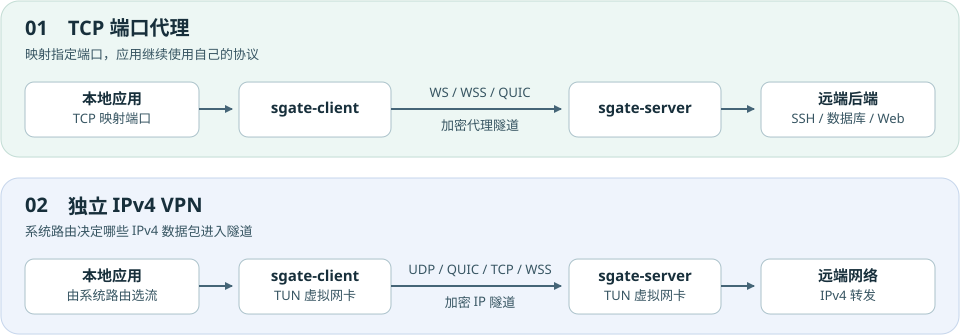
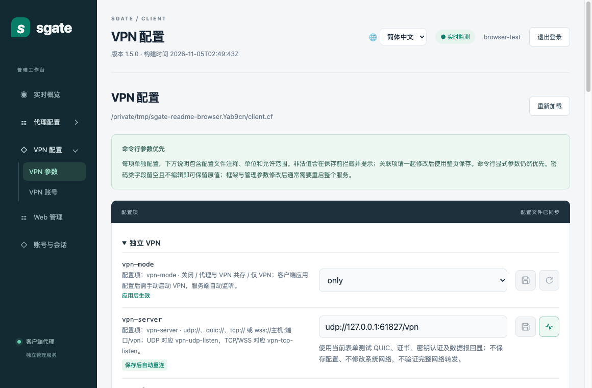
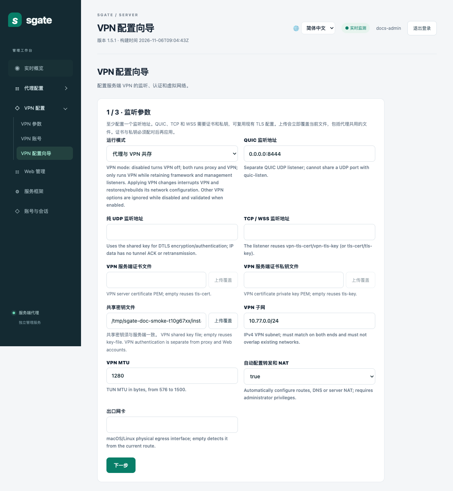
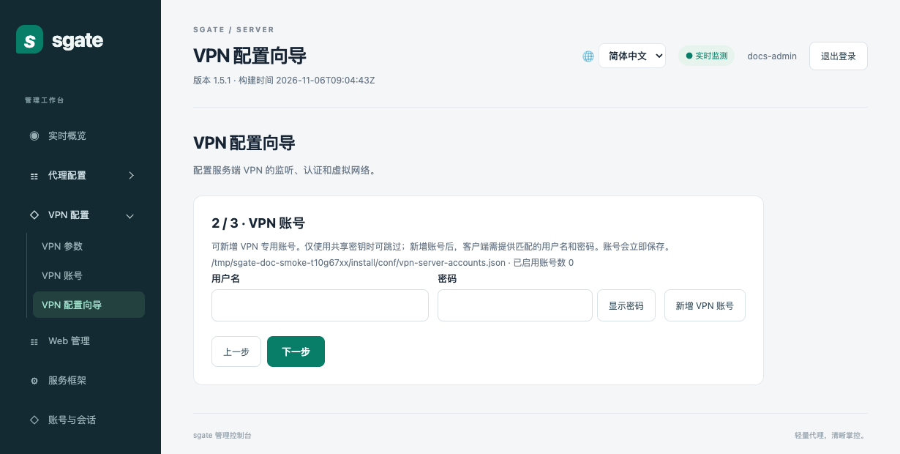
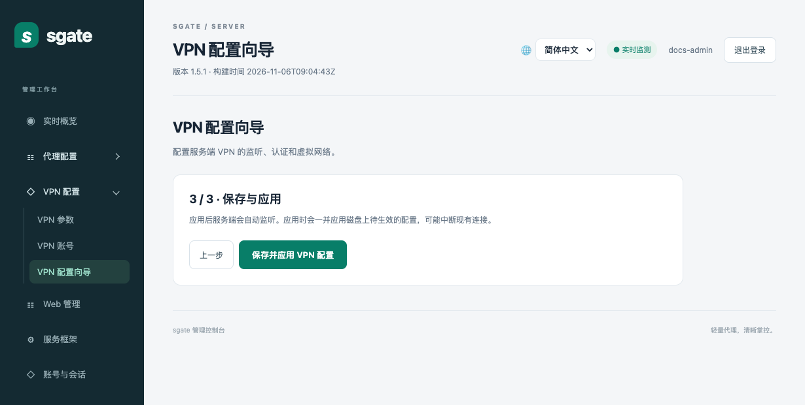
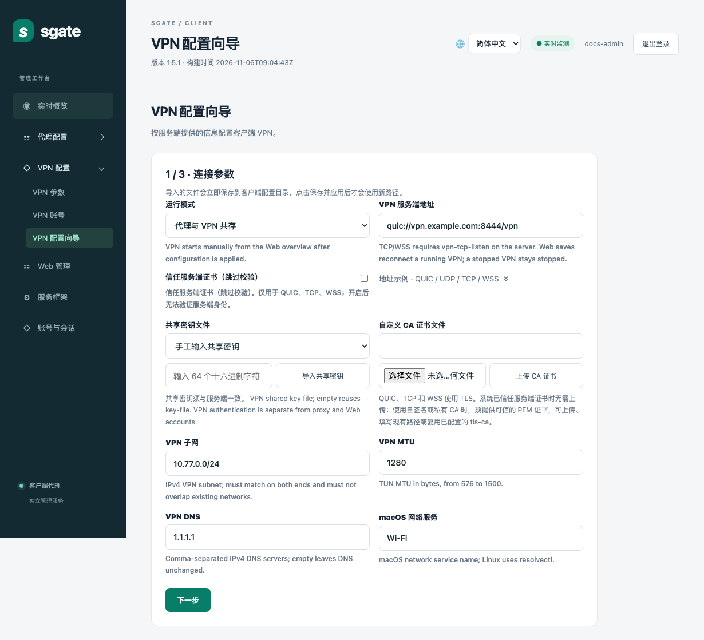
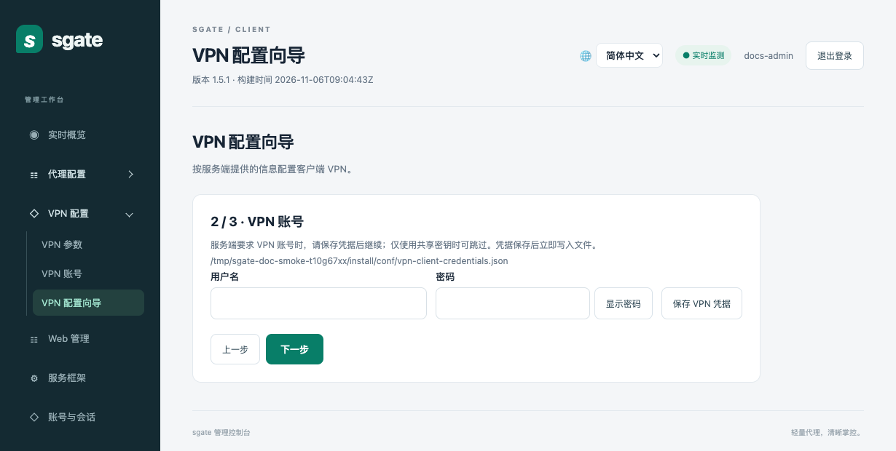
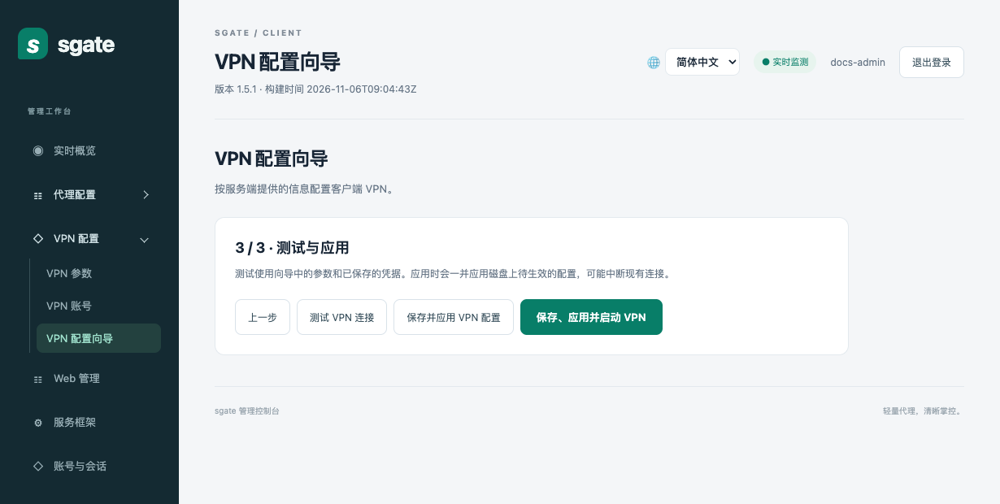

# sgate

**加密 TCP 端口代理 · 独立 IPv4 VPN**

当前版本 `1.5.4` · [English documentation](README.en.md)

sgate 用两个进程连接本地与远端网络。只需访问 SSH、数据库或内网 Web 服务时，映射所需 TCP 端口即可。希望应用按系统路由访问远端网络时，可以启用独立 VPN。两种模式可同时运行，并可通过 Web 管理界面配置和观察。



## 先选使用场景

| 你想做什么 | 选择 | 应用如何接入 |
| --- | --- | --- |
| 从本机访问远端 SSH、数据库或内网 Web | **TCP 端口代理** | 连接本机映射端口。客户端可配置多条映射 |
| 让服务端一侧访问客户端内网的 TCP 服务 | **反向 TCP 代理** | 服务端监听反向端口，由已授权客户端连接内网目标 |
| 让浏览器等应用按系统路由走 VPN | **独立 IPv4 VPN** | 应用照常运行，系统把匹配路由的 IP 包交给虚拟网卡 |

客户端支持 **macOS、Linux、Windows**。服务端支持 **macOS、Linux**。Windows 包另附独立控制 APP，可启动和停止客户端进程，并打开 Web 管理界面。开启 VPN 需要虚拟网卡和网络管理权限。 [Windows 客户端指南](docs/vpn.md#windows-客户端)

## 快速安装

**macOS / Ubuntu** 选择对应架构的 `sgate-1.5.4-<系统>-<架构>.tar.gz`。Apple Silicon 和 ARM64 Ubuntu 用 `arm64`，Intel Mac 和常见 x86_64 Ubuntu 用 `amd64`。解压后运行包内的安装脚本。以下用 Apple Silicon 和用户目录举例。

```sh
shasum -a 256 -c sgate-1.5.4-macos-arm64.tar.gz.sha256  # Ubuntu 可用 sha256sum -c
tar -xzf sgate-1.5.4-macos-arm64.tar.gz
cd sgate-1.5.4-macos-arm64
PREFIX="$HOME/.local/sgate" ./install.sh
```

系统级安装可运行 `sudo ./install.sh`，默认目录为 `/opt/soft/sgate`。安装包包含两端程序、配置模板和 Web 文件。安装会保留已有配置和密钥，且不启动服务。

**Windows** 双击安装包，安装完成后从开始菜单打开 **sgate Client**。也可解压便携包，运行 `bin/sgate-control.exe`。首次连接服务器前需配置服务器地址和共享密钥。使用 VPN 时，以管理员权限运行客户端，并将与客户端架构匹配的 `wintun.dll` 放在 `sgate-client.exe` 同目录。 [Windows 构建和部署](docs/vpn.md#windows-客户端)

**从源码构建** 需要 Go 1.24 或更新版本。在仓库根目录运行 `make build`，将客户端、服务端和独立 `sgate-vpn` 编译到 `bin/`，再用 `sudo make install` 安装；跨平台打包可运行 `./package/package-release.sh ubuntu amd64` 或 `./package/package-release.sh macos arm64`。Windows 安装包构建入口是 `package\build-windows-installer.bat`。运行 `sgate-client -version` 查看版本，或用 `sgate-server -verbose` 同时查看构建时间。

## 第一次跑通代理

以下用同一台 macOS 或 Ubuntu 机器验证。默认模板让客户端的 `127.0.0.1:9000` 经服务端的 `127.0.0.1:8081` 访问后端 `127.0.0.1:8080`。若示例端口已被占用，请选用空闲端口，并同步修改两端的 `.cf`、客户端的 `conf/sgate-proxies.json` 和下方命令。

服务端两种启动方式统一使用 `master_service = 127.0.0.1|8081`：独立模式由程序监听，托管模式由 acl_master 监听并传入句柄。无需再配置单独的 `listen`；设置 `tls-cert`、`tls-key` 后使用 HTTPS/WSS。

客户端只通过端口映射建立代理连接，独立 `server` 配置项不再生效，`-server` 参数已移除。首次安装的 `conf/sgate-proxies.json` 初始化为 `[]`，客户端保持空闲；在前端添加映射后，使用各条映射的 `listen`、`server` 和可选 `addr`，并自动同步框架 `master_service`。客户端配置文件中的未知项（包括旧 `listen`、`server`）会记录警告后忽略，不会阻止启动；日志给出文件、行号及项名，不记录取值。已有独立 `server` 配置应改为端口映射，忽略旧项不会恢复旧代理连接。

1. 在安装目录的 `conf/sgate-client.cf` 和 `conf/sgate-server.cf` 中，把示例 `password` 改成相同的自选密码。同一安装目录下的两端共用 `conf/sgate.key`。
2. 分别打开三个终端，运行下面的三个程序（HTTP 后端需要 Python 3）。若用的是系统级安装，将 `$HOME/.local/sgate` 换成实际安装目录，并以有权读取配置的用户运行。

```sh
# 终端 1：启动仅供测试的 HTTP 后端
demo=$(mktemp -d)
printf 'sgate OK\n' > "$demo/index.html"
python3 -m http.server 8080 --bind 127.0.0.1 --directory "$demo"

# 终端 2：启动 sgate 服务端
"$HOME/.local/sgate/sbin/sgate-server" -alone -f "$HOME/.local/sgate/conf/sgate-server.cf"

# 终端 3：启动 sgate 客户端
"$HOME/.local/sgate/sbin/sgate-client" -alone -f "$HOME/.local/sgate/conf/sgate-client.cf"

# 另开终端验证，应看到 sgate OK
curl --noproxy '*' http://127.0.0.1:9000/
```

3. 打开客户端管理页 `http://127.0.0.1:9081/` 和服务端管理页 `http://127.0.0.1:8081/admin/`。首次登录按启动日志提示读取初始化令牌文件（由各自的 `admin_setup_token_file` 指定），并创建独立的 Web 管理员账号。

只测试命令行代理时，保持上述 HTTP 后端运行，在源码目录执行 `make build` 后，分别在两个终端运行 `./server-alone.sh` 和 `./client-alone.sh`。安装后对应脚本位于安装目录的 `bin/`。它们以前台 alone 模式运行，按 Ctrl+C 退出；默认使用同一份 `sgate.key` 和测试密码 `sgate-test-password`，将 `127.0.0.1:9000` 转发到 `127.0.0.1:8080`。脚本直接传入命令行参数，不加载 `.cf`，也不启用管理页。

可以追加参数覆盖默认值，例如 `./client-alone.sh -master_service 127.0.0.1:9001`。两端均支持通过 `SGATE_PASSWORD`、`SGATE_KEY_FILE` 环境变量或追加的 `-password`、`-key-file` 指定相同的密码和共享密钥。

部署到两台机器时，客户端在「代理配置 → 代理映射」填写服务端地址，服务端填写后端目标，并只开放所需的监听。两端使用相同的共享密钥及匹配的代理凭据。若映射单独指定后端，将它加入服务端 `allowed-targets`。跨公网使用 WSS 或 QUIC 时，配置证书并校验服务端名称。 [部署参考与反向代理](docs/reference.md) · [配置示例](samples/README.md)

客户端可在「代理配置 → 代理连接」的 `key-file` 项下修改共享密钥文件内容。保存新密钥后，使用「保存并应用」让运行中的配置读取它。

## 启用独立 VPN

可以使用下方的 [Web 配置向导](#web-配置向导)，也可以在「VPN 参数」页手动配置。

1. **服务端** 在「VPN 配置 → VPN 参数」把 `vpn-mode` 设为 `both`（代理与 VPN 共存）或 `only`（仅 VPN），选择监听地址并应用。TCP 和 WSS 共用 `vpn-tcp-listen`，QUIC 使用 `vpn-quic-listen`，纯 UDP 使用 `vpn-udp-listen`。
2. **客户端** 选择对应模式，填写 `vpn-server`，例如 `quic://vpn.example.com:8444/vpn`。两端的 VPN 子网、MTU 和共享密钥须匹配。使用私有 CA 时，在客户端设置 `vpn-tls-ca` 或复用 `tls-ca`。服务端在认证后自动分配虚拟 IPv4 地址。
3. 修改 URL 后，可以直接点保存图标右侧的「测试 VPN 连接」。测试使用当前表单，检查连接、认证和回显，无需保存，也不会接管系统路由。
4. 保存并应用后，在客户端「实时概览」手动启动 VPN。进程启动或重启后仍需手动启动。停用时点击「停止 VPN」恢复网络设置。发现上次留下的恢复记录时，页面会提示先确认清理。

启动前请检查 `vpn-routes` 和 DNS 设置。示例中的两条 IPv4 `/1` 路由覆盖全部 IPv4 地址。需要按用户授权时，两端在「VPN 账号」页配置专用凭据。服务端可新增、修改、禁用和删除账号。代理账号、VPN 账号与 Web 管理员账号分别管理。 [VPN 完整部署、权限与路由说明](docs/vpn.md)



## Web 配置向导

先配置服务端，再配置客户端。登录各自的 Web 管理页后，在侧栏选择「VPN 配置向导」。以下以 QUIC 为例。

### 服务端

1. **监听参数**。选择「代理与 VPN 共存」或「仅 VPN」，填写至少一个监听地址。QUIC 示例使用 `0.0.0.0:8444`。为 QUIC、TCP 或 WSS 配置匹配的 TLS 证书和私钥，或复用已有的 TLS 文件。确认共享密钥、VPN 子网和 MTU，并按部署环境设置转发和 NAT。
2. **VPN 账号**。需要按用户认证时，填写用户名和密码，点击「新增 VPN 账号」。账号立即保存。仅使用共享密钥时可直接进入下一步。
3. **保存与应用**。点击「保存并应用 VPN 配置」。服务端会自动尝试启动监听，在「实时概览」确认监听状态。



<details>
<summary>查看服务端向导第 2、3 步</summary>





</details>

### 客户端

1. **连接参数**。选择运行模式，填写服务端提供的地址，例如 `quic://vpn.example.com:8444/vpn`。使用同一共享密钥，并匹配服务端的子网和 MTU。服务端使用自签名证书或私有 CA 时，提供可信的 PEM 证书。
2. **VPN 账号**。服务端要求账号时，输入对应的用户名和密码，点击「保存 VPN 凭据」后继续。仅使用共享密钥时可跳过。
3. **测试与应用**。点击「测试 VPN 连接」，用当前参数和已保存的凭据检查连通性、认证和回显。确认后可选择「保存并应用 VPN 配置」，再到「实时概览」手动启动，也可选择「保存、应用并启动 VPN」并在向导中查看连接状态。



<details>
<summary>查看客户端向导第 2、3 步</summary>





</details>

客户端导入文件时立即写入配置目录，应用后才会使用新路径。服务端的「上传覆盖」会立即替换现有文件，包括代理共用的文件。两端应用时也会一并应用磁盘上待生效的配置，可能中断现有连接。

## 为什么这样设计

**代理按连接转发，VPN 按 IP 包转发。** 端口代理只转发选定的 TCP 服务，无需改变系统路由。VPN 通过虚拟网卡接管配置的 IPv4 路由，适合多个应用共用一条隧道。两者使用不同入口，代理 URL 通常是 `/tunnel`，VPN URL 使用 `/vpn`。

**代理断线恢复有明确边界。** WS/WSS 用一条连接复用多路 TCP。原生 QUIC 则为每个业务连接分配独立流，并分别维护确认、队列和重放状态，减少慢连接拖住其他连接的机会。短时断线可在保留窗口内恢复，缓存和流数上限用于控制资源占用。 [代理架构和协议](docs/architecture.md) · [QUIC 性能基线](docs/quic-performance.md)

**VPN 允许按链路选择外层传输。** 四种方式都加密并支持 VPN 专用账号。实际选择应看目标网络的连通性、负载下延迟和吞吐。

| VPN 方式 | 数据怎样传 | 何时考虑 |
| --- | --- | --- |
| `quic://` | QUIC DATAGRAM 承载 IP 包，使用 QUIC 拥塞控制，IP 数据报不重传 | UDP 路径稳定，希望使用 QUIC 拥塞控制 |
| `udp://` | DTLS 加密。握手及部分控制包可重试，业务包不由隧道重传 | 希望减少外层重传，由内层协议自行处理丢包 |
| `tcp://` | TLS/TCP 可靠传输 | UDP 受限，需要直接走 TCP |
| `wss://` | TLS 上的 WebSocket 可靠传输 | 部署入口需要标准 WebSocket |

同一个连接的 TCP/WSS 可靠传输会按序交付，弱网时丢包可能拖延后续数据。QUIC DATAGRAM 和纯 UDP 允许业务数据丢失，应用表现取决于内层协议和链路。纯 UDP 仅用于独立 VPN，TCP 端口映射的应用入口仍然是 TCP。 [纯 UDP 协议与测试](docs/vpn-udp.md)

## 继续阅读

- [部署与测试参考](docs/reference.md) · 参数详解、TLS、acl_master、反向代理、白噪音和历史回归记录
- [实时监控与性能](docs/quic-performance.md) · QUIC 指标、测试口径与弱网基线
- [配置示例](samples/README.md) · SSH、Web、账号、多端口映射与测试证书

许可证见 [LICENSE](LICENSE)。
