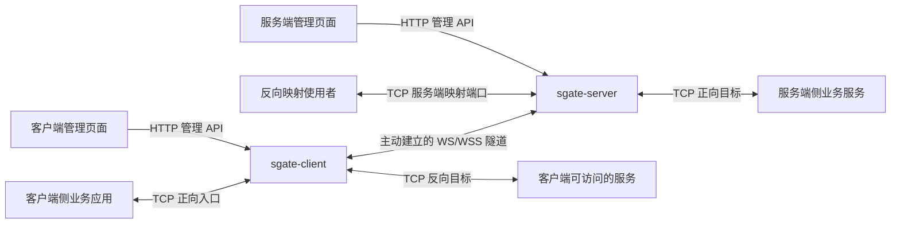
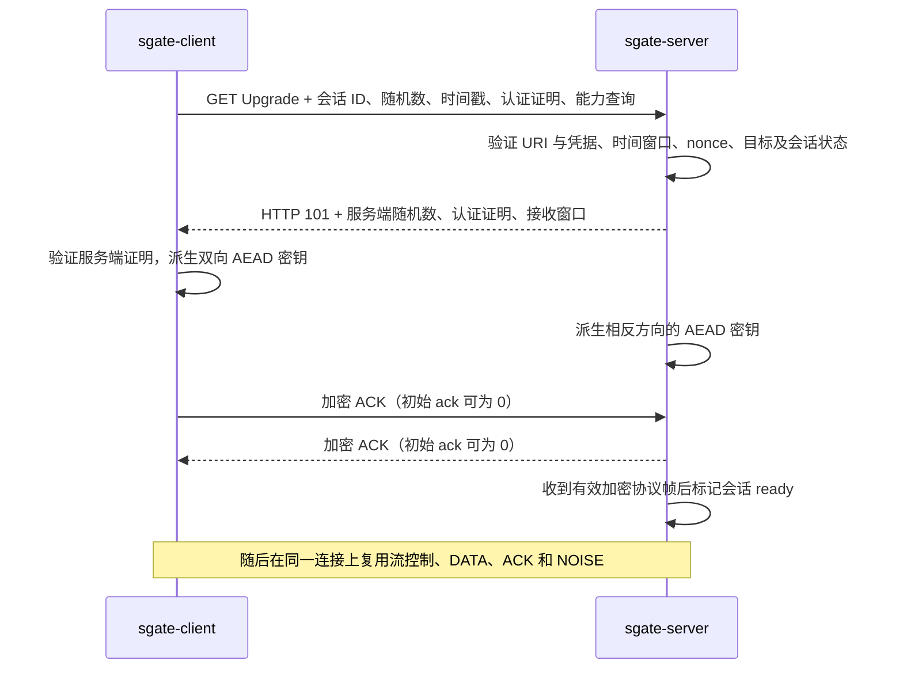
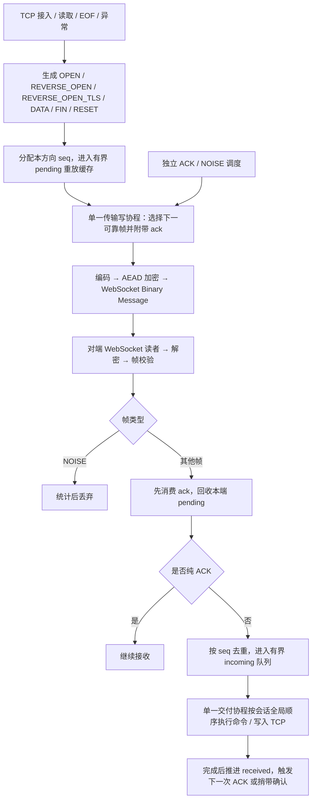
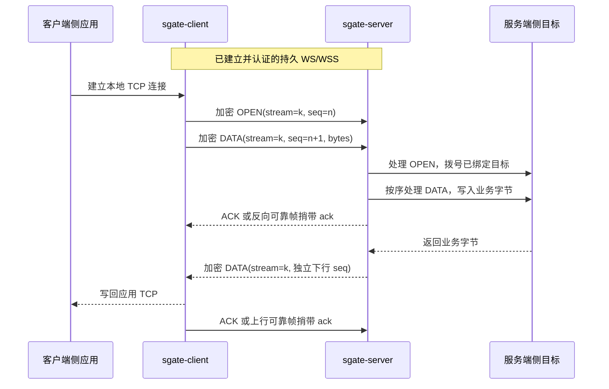
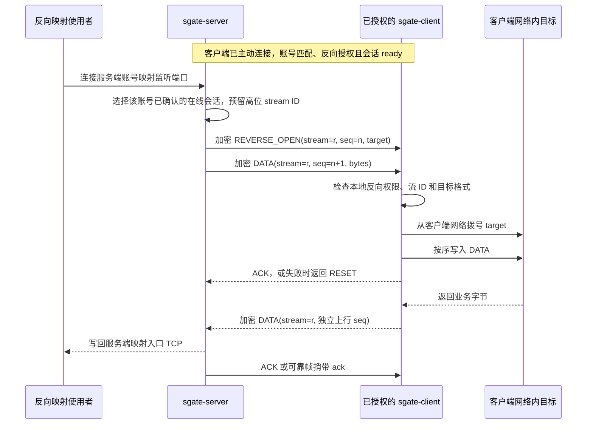
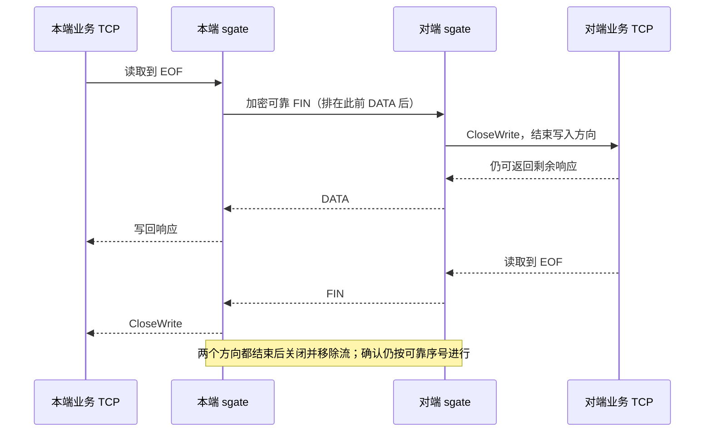
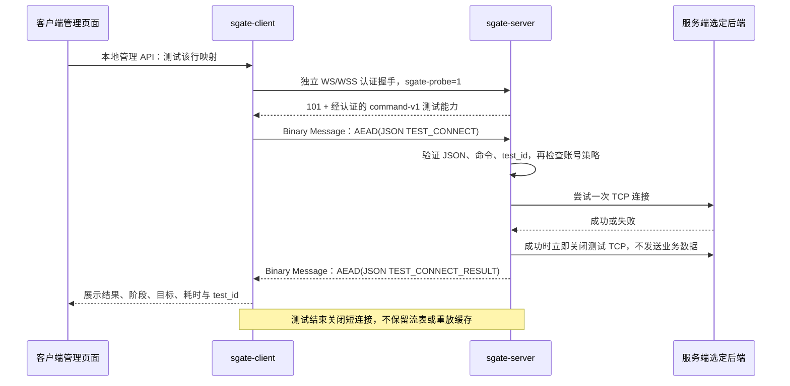

# sgate 整体架构与隧道协议

本文依据当前仓库实现编写，协议标识为 `sgate-v1`。重点说明客户端与服务端之间的数据分类、命令、收发顺序、可靠性和生命周期；部署参数见 [README](../README.md)。文中的“包”是逻辑协议帧，不等同于 TCP/IP 网络包。

UDP 传输入口为 `quic://`，服务端以 `quic-listen` 监听 UDP，ALPN 为 `sgate-quic-v1`，TLS 最低版本为 1.3。每条 QUIC 连接仅接收一条双向流，通过 `quicStreamConn` 适配 `net.Conn`，在该流上复用现有 HTTP Upgrade、WebSocket 消息、认证及会话恢复逻辑；下文的逻辑协议同样适用。它不是 HTTP/3，不提供原始 UDP 业务转发，且当前仍有单条有序流导致的跨业务流等待。UDP 监听属于应用 worker；共享入口更新仅替换其目标处理器，整进程关闭时释放 QUIC transport 和 UDP socket。关闭单条流时先发送 FIN，并在有界等待期间保留 QUIC 重传机会，避免立即关闭连接丢失最终探测响应。

## 1. 当前实现的结论

长连接中的**业务负载和流控制命令已经区分**，但使用统一帧头中的 `op` 字段区分，共用同一条双向 WebSocket。没有为每个业务 TCP 流各建一条 WebSocket，也没有独立的长连接命令通道。

需要区分以下三层：

| 层次 | 承载内容 | 编码及连接 | 是否参与业务重放 |
| --- | --- | --- | --- |
| 长连接业务协议 | `DATA`；`OPEN`、`REVERSE_OPEN`、`REVERSE_OPEN_TLS`、`FIN`、`RESET`；`ACK`；`NOISE` | 统一二进制帧经 AES-256-GCM 加密，放入 WebSocket Binary Message | `OPEN`、`REVERSE_OPEN`、`REVERSE_OPEN_TLS`、`DATA`、`FIN`、`RESET` 参与；`ACK`、`NOISE` 不参与 |
| 连通性测试协议 | `TEST_CONNECT`、`TEST_CONNECT_RESULT` | 独立短时 WS/WSS 连接，JSON 经同一类 AEAD 加密封装；不套长连接的 25 字节帧头 | 不创建业务会话，不重放 |
| WebSocket 控制协议 | Ping、Pong、Close | WebSocket 自身的控制帧，不属于 sgate 的 `op` 帧 | 不参与 |

因此，“命令包”有两种具体实现：长连接内的二进制流控制帧，以及短连接内的 JSON 测试命令。二者不能混用。`NOISE` 是随机填充，既不是业务数据，也不向业务 TCP 执行命令。

## 2. 组件与连接关系



- **客户端映射运行器**：每条客户端地址映射运行独立 `tunnel.Client`，主动建立 WebSocket。即使尚无正向业务连接，也会拨号，供反向代理使用。多条映射可以使用相同账号，但各自拥有独立会话、可靠序号、缓存和反向授权。
- **服务端隧道服务**：负责握手认证、账号绑定、会话索引、目标选择和反向监听；每个业务流对应一端实际 TCP 连接。
- **`session`**：跨 WebSocket 重连保留的逻辑会话，拥有流表、双向可靠协议状态、发送重放缓存和接收交付队列。
- **`transport`**：一次 WebSocket 连接及其加密状态。一个会话同一时刻只允许一个活动传输；每次重连重新派生密钥并启动收发工作。
- **框架层**：客户端由 go-service 管理 TCP 入口；服务端由 gin-service 管理 HTTP/TLS 生命周期。独立模式由框架绑定端口，托管模式使用 `acl_master` 继承的监听。
- **管理面**：配置、账号保存、统计、应用配置和整服务重启通过管理 HTTP API 执行，不是隧道中的远程命令。Web 管理账号与 `tunnel-accounts.json` 中的隧道账号是两套身份。

服务端反向映射端口在托管模式下通过 `LeaseTCP` 从框架取得原始 TCP 监听，不送入 HTTP 解析；按映射配置选择是否在该原始入口终止 TLS。HTTP 的同一服务端口可能由 `acl_master` 展开为多条 IPv4、IPv6 或带作用域的网卡监听；其接入地址由父进程决定。反向端口与 WebSocket 隧道服务端口必须不同，即使绑定不同 IP 也不允许复用。

## 3. 握手与能力协商

所有正式长连接和测试短连接都由客户端发起 HTTP GET Upgrade；服务端不会主动向客户端建立新的 WebSocket。



关键字段如下：

| 字段 | 作用 |
| --- | --- |
| `X-Sgate-Session` | 32 字节随机值的十六进制会话 ID；重连保留，新会话更换 |
| `X-Sgate-Nonce` | 每次握手的新随机数；服务端响应也提供独立随机数 |
| `X-Sgate-Time` | Unix 秒时间戳，接受当前时间前后 60 秒窗口 |
| `X-Sgate-Resume` | `0` 表示创建，`1` 表示恢复已有会话 |
| `X-Sgate-Password` | 加密认证凭据；旧公共密码模式为 `v1.`，账号与密码模式为 `v2.` |
| `X-Sgate-Auth` | HMAC-SHA256 认证证明；请求绑定会话、nonce、时间、恢复标志、完整 RequestURI 和凭据；响应绑定服务端 nonce 等上下文 |
| `addr` | 可选正向目标，由服务端 `allowed-targets` 精确允许列表检查；不提供则用服务端默认 `target` |
| `sgate-window` / `X-Sgate-Receive-Window` | 双向接收窗口协商；请求包含在已认证 URI 中，响应窗口纳入服务端证明 |
| `sgate-stream-errors=1` | 客户端请求详细 RESET 原因码，服务端保存为该会话能力 |
| `sgate-reverse-tls=1` | 已授权客户端声明支持反向 TLS 目标命令；与普通反向能力一起认证并绑定会话，恢复时必须一致 |
| `sgate-reverse=1` | 有名账号客户端在本地明确授权后声明反向能力；包含在已认证 URI 中 |
| `sgate-probe=1` | 选择独立短连接测试模式；响应另验证 `X-Sgate-Probe: command-v1` 和 `X-Sgate-Probe-Auth` |

服务端验证已使用过的客户端 nonce，拒绝握手重放。恢复时还检查账号、正向目标、反向能力及诊断能力是否与原会话一致，并拒绝同时占用同一会话。单纯收到 HTTP 101 或 Ping/Pong 不算完成会话恢复确认：必须在原会话保留期限内收到可解密且合法的 sgate 协议帧。有效 `NOISE` 也可确认，但 WebSocket 控制帧不能延长未确认恢复的原期限。

客户端会先删除 URL 中的 `sgate-reverse` 和 `sgate-reverse-tls` 参数，再根据本地映射的 `allow_reverse` 重新决定是否添加。URL 无法绕过本地授权；客户端接收 `REVERSE_OPEN` 或 `REVERSE_OPEN_TLS` 时仍会再次检查权限。

## 4. 长连接的线格式

### 4.1 WebSocket 消息与加密层

当前每次 `WriteMessage(BinaryMessage, ...)` 写出一个加密后的逻辑帧：

```text
WebSocket Binary Message
└─ counter: 8 字节，大端、当前传输方向的加密计数器
└─ ciphertext: AES-256-GCM 加密的 [25 字节头 | 可选内容]
└─ GCM tag: 16 字节
```

- 当前传输的每个方向分别从 `counter=1` 开始；接收端严格要求下一个计数器等于前一个加一。
- 密钥由预共享密钥、`sgate-v1`、会话 ID、双方本次随机数及方向派生；上下行密钥不同，每次重连也不同。
- GCM nonce 为 12 字节：前 4 字节为零，后 8 字节为当前计数器；AAD 为 `sgate-v1`。
- `op`、可靠序号、ACK、流 ID 和内容都在密文中。传输计数器在密文外，但参与 GCM nonce，篡改不能通过认证。
- 一个完整 WebSocket 消息在网络上可以被分片，也可以跨多个 TCP 段；TCP Read/Write 的边界不是业务消息边界。

### 4.2 解密后的统一帧

```text
偏移       0        1                 9                 17                25
           +--------+-----------------+-----------------+-----------------+---------+
           | op: 1B | seq: 8B         | ack: 8B         | stream: 8B      | data... |
           +--------+-----------------+-----------------+-----------------+---------+
```

| 字段 | 含义 |
| --- | --- |
| `op` | 下表中的操作类型 |
| `seq` | 本方向、整个会话的可靠帧序号；跨流共享，跨重连连续 |
| `ack` | 本端已经连续完成处理的对向可靠帧序号，含该序号及之前所有帧 |
| `stream` | 业务 TCP 流 ID；同一流的双向数据使用同一 ID |
| `data` | 根据 `op` 解释；没有另设长度字段，由解密后的消息长度确定，最多 16384 字节 |

加密开销为每条消息 24 字节，长连接协议头为 25 字节，因此单条 `DATA` 的 WebSocket 消息载荷最大为 `16384 + 25 + 24 = 16433` 字节；这不包含 WebSocket、TLS 和 TCP/IP 开销。

**三种编号相互独立**：`stream` 标识哪条 TCP；`seq/ack` 支持可靠重放；`counter` 支持本次加密传输的顺序与认证。重连保留 `stream`、`seq/ack`，但重置 `counter` 并更换密钥。

## 5. 长连接命令及负载类型

表中的方向是逻辑发起方向；所有类型均由对端验证解密后处理。

| `op` | 名称与类别 | 方向 | `data` 内容 | 是否分配可靠 `seq`、保留待确认副本 | 接收效果 |
| --- | --- | --- | --- | --- | --- |
| `0` / `0x00` | `ACK`，确认控制 | 双向 | 空 | 否；`seq=0`、`stream=0` | 按 `ack` 回收已确认发送缓存 |
| `1` / `0x01` | `OPEN`，正向建流命令 | 客户端 → 服务端 | 空 | 是 | 为该流拨号到握手时绑定的服务端正向目标 |
| `2` / `0x02` | `DATA`，业务负载 | 双向 | 1～16384 字节原始 TCP 字节 | 是 | 写入该流对应的本地 TCP 套接字，不解释 SSH/HTTP 等业务协议 |
| `3` / `0x03` | `FIN`，半关闭命令 | 双向 | 空 | 是 | 对该流执行 `CloseWrite`，允许相反方向继续返回数据 |
| `4` / `0x04` | `RESET`，异常关闭命令 | 双向 | 空，或 1 字节原因码 | 是 | 关闭并移除该业务流，不要求销毁其他流 |
| `5` / `0x05` | `NOISE`，随机填充 | 双向 | 1～16384 字节随机内容 | 否；`seq=ack=stream=0` | 解密校验及计数后丢弃，不交给业务 TCP |
| `6` / `0x06` | `REVERSE_OPEN`，反向建流命令 | 服务端 → 客户端 | 目标 `host:port` 字符串 | 是 | 经本地授权检查后，从客户端网络拨号该目标 |
| `7` / `0x07` | `REVERSE_OPEN_TLS`，反向 TLS 建流命令 | 服务端 → 客户端 | 目标 `host:port` 字符串 | 是 | 经本地授权检查后，用 TLS 连接客户端网络目标并验证证书链及主机名 |

除 `ACK` 和 `NOISE` 外，帧的 `seq`、`stream` 必须非零；未知 `op` 或不合法的字段组合会被拒绝。正向新建流 ID 范围为 `1 .. 2^63-1`，反向为 `2^63+1 .. 2^64-1`，`0` 和 `2^63` 不用于新建业务流。

当前没有 `OPEN_OK`、`REVERSE_OPEN_OK` 或应用层请求结果命令。`OPEN` 和 `DATA` 按可靠序号先后交付，拨号失败通过可靠 `RESET` 反馈。收到 ACK 只表示对应帧已处理；拨号失败并安排 RESET 后也可能推进 ACK，因此不能把 ACK 当成建连成功回复。

`REVERSE_OPEN` / `REVERSE_OPEN_TLS` 携带地址是受限的网络拨号命令，不是 shell 命令。当前没有执行任意系统命令、上传文件、远程修改配置或重启进程的隧道 `op`。

### 5.1 RESET 原因码

| 码值 | 含义 |
| --- | --- |
| `1` | 目标 TCP 拨号失败，未归入更具体类别 |
| `2` | 目标拨号超时 |
| `3` | DNS 解析失败 |
| `4` | 目标拒绝连接 |
| `5` | 网络或主机不可达 |
| `6` | 流数达到上限 |
| `7` | 本地 TCP 读取失败 |
| `8` | 本地 TCP 写入或半关闭失败 |

服务端根据握手中的 `sgate-stream-errors=1` 决定是否在 RESET 中携带详细原因，并返回 `X-Sgate-Stream-Errors: 1` 及 `X-Sgate-Stream-Errors-Auth`。确认签名使用共享密钥，绑定协议、用途、会话 ID 和本次双方 nonce。客户端验证该确认后，也在发往服务端的 RESET 中携带原因，因此反向目标拒绝连接等错误可直接在服务端定位；每次重连重新确认。没有确认头的旧服务端仍接收空 RESET，确认存在但无效时拒绝连接。

空内容 RESET 用于未提供详细原因的关闭，旧端兼容依赖此形式；接收端只接受空内容或上述一个字节，不接受任意错误文本。原始系统错误留在本端日志，避免混入业务字节流。原因码没有新增，旧客户端仍可连接新服务端；要获得客户端发回的详细原因，需要更新两端并重新建立传输。

## 6. 命令包与业务负载的共同收发管线



可靠命令与 `DATA` 共用 `pending` 和序号顺序，未实现命令优先级队列或每个流的独立调度通道。RESET 请求先进入有界异步控制队列，再进入同一可靠发送缓存，避免 WebSocket 读者阻塞在发送缓存上；该控制队列溢出时关闭会话以限制资源。

写协程在循环中检查心跳、Pong 和噪音调度。存在下一可靠帧时先发该帧并捎带当前 ACK；没有可发送的可靠帧但 ACK 有变化时，发送独立 `ACK`。每次传输开始也会发送一次当前 ACK，即使为零。噪音按最多 16 KiB 一块穿插发送，较大批次不会一次构造一个巨大 WebSocket 消息。

只有一个普通数据写协程负责应用帧及常规 Ping/Pong 调度；读者收到 Ping 后只放入容量为 1 的最新 Pong 邮箱，避免等待写入而阻止 ACK 消费。主动结束会话的 Close 通知使用 WebSocket `WriteControl` 的独立控制写接口。

## 7. 正向代理：命令先建流，DATA 承载字节



`OPEN` 不携带目标地址。目标在 WebSocket 握手时由默认 `target` 或经允许列表检查的 `addr` 确定，整个会话中的正向流共用该目标；恢复时也不能改变，以免把旧缓存发往别的服务。不同目标通常配置为不同客户端地址映射及独立隧道。

客户端可在对端完成拨号前读取业务字节并排入 OPEN 之后；对端交付协程先完成 OPEN 的处理，再处理后续 DATA。拨号或流数检查失败时返回 RESET，不向应用 TCP 注入错误提示文本。

## 8. 反向代理：服务端下发 REVERSE_OPEN



反向入口归属由服务端账号的 `reverse_mappings` 决定；客户端目标可以是 `127.0.0.1`、其他 IP 或符合规则的主机名。该目标不是服务端正向的 `allowed-targets`，客户端也没有额外的反向目标允许列表：当前安全边界是每条客户端映射默认关闭的 `allow_reverse`，以及对服务端及其账号配置权限的信任。

服务端只选择同账号、声明反向能力、正在使用且已确认的会话。若同账号有多条合格隧道，按会话 ID 排序选择首条，不是负载均衡或广播。没有可用会话、流数已满或无足够发送缓存时，关闭新接入的反向 TCP；不无限排队等待客户端上线。正反向流共用该会话的流数和缓存额度。

客户端不允许接收反向命令时，不能因伪造 URL 或高位 ID 而拨号。开启授权后，服务端可请求该客户端连接其网络可达目标，授权范围不只限于回环地址。

### 8.1 反向映射两端的 SSL/TLS

每条映射分别配置 `listen_tls` 和 `target_tls`，缺省均为 `false`。SSL 选项实际使用现代 TLS，最低 TLS 1.2，不启用旧 SSL 协议。

- `listen_tls=true`：服务端在反向入口终止 TLS。省略 `listen_tls_cert` / `listen_tls_key` 时复用服务端已加载的隧道证书；也可同时填写独立 PEM 证书与私钥路径。路径在服务端文件系统解析，相对路径沿用服务端工作目录；推荐绝对路径。若隧道 TLS 在外部网关终止、sgate 自身未加载证书，则必须提供独立证书。
- `target_tls=true`：服务端只选择通过认证声明 `sgate-reverse-tls=1` 的在线客户端，发送 `REVERSE_OPEN_TLS`，内容仍是目标地址。客户端以该地址的主机名或 IP 验证目标证书，系统根证书默认生效；客户端的 `tls-ca` 可补充私有 CA。不会把服务端证书路径或私钥传给客户端，也不会关闭证书验证。
- 普通反向目标仍使用原 `REVERSE_OPEN`。对不支持新命令的旧客户端，不将 TLS 请求降级为明文；没有合格客户端时关闭新入口连接。
- 入口 TLS 握手、目标 TCP 拨号及目标 TLS 握手均受连接超时约束。入口握手占用已受限的流名额；失败只重置该流。会话退出直接关闭 TLS 底层连接以打断阻塞，正常 FIN 仍进行 TLS 写方向关闭。
- 两端 TLS 可独立组合。服务端解密入口字节后，仍通过原 AEAD WebSocket 传输；客户端按配置再进行目标 TLS 握手。这是两段 TLS 的终止和重建，不是透明透传一段端到端 TLS，也不执行 STARTTLS 升级。

```text
外部使用者 -- 可选 TLS --> sgate-server
           == 已认证且加密的 WS/WSS 隧道 ==>
sgate-client -- 可选 TLS --> 客户端网络目标
```

证书文件在创建、保存和启动时预检；缺失、无效或不匹配时拒绝本次配置并保留原策略。托管模式也在写入待重启配置前验证证书，避免保存成功后因证书错误无法启动。相同端口上的 TLS 开关或证书路径变化可在线应用，会按账号策略更新规则关闭该账号旧会话；端口集合变化继续走整服务重启流程。

## 9. FIN、RESET 与会话结束



TCP 读写异常、拨号失败或限额拒绝使用 RESET。收到 RESET 立即释放对应 TCP 和流表项；重置后的在途 DATA 可以被消费并丢弃，不能交给后续新流。命令非法、可靠序号跳号、非法 ACK 或认证失败等协议级错误可能结束传输或整个会话，与单流业务错误不同。

**流结束与会话结束不同**：FIN/RESET 只针对一个 `stream`。有名账号客户端主动关闭会话时，尽力在 100 ms 内发送 WebSocket 正常 Close，内容为 `sgate-end:<proof>`；proof 是绑定会话 ID 及本次双方 nonce 的 HMAC。服务端仅在证明匹配时立即关闭并删除对应保留会话。普通网络中断、普通 Close、伪造或旧传输重放的证明不会触发该主动销毁路径，仍遵循会话保留规则。通知无法送达时，服务端仍需依靠断线检测和保留期限清理。

## 10. ACK、背压和断线重放

### 10.1 可靠性单位是整个会话的单个方向

以客户端 → 服务端方向为例：

1. 可靠命令和 DATA 入发送缓存时统一递增 `next`，分配 `seq`。
2. WebSocket 写成功后仍保留 `pending` 副本，直到收到服务端的累计 `ack`。
3. 服务端验证并接收入队时推进 `accepted`，尚未推进对外确认的 `received`。
4. 交付协程处理完成后推进 `received`。DATA 要求全部字节成功写入对应 TCP 套接字；控制帧要求完成其处理逻辑。
5. 服务端通过独立 ACK 或反向可靠帧的 `ack` 字段反馈 `received`；客户端释放 `seq <= ack` 的副本，并唤醒等待缓存的读取者。
6. `seq <= accepted` 的重放帧只去重，不重复入队；下一新帧必须为 `accepted+1`。`ack > next` 被拒绝。

另一方向独立运行同一套机制。ACK 不是目标应用已经读取、持久化或完成事务的证明；已经失败并处理的流也可能有对应可靠帧被确认。

### 10.2 有界缓存及队头等待

每个会话每方向默认有 4 MiB 发送重放缓存，接收交付队列也以 `buffer-bytes` 为上限；额度计算包含每帧 25 字节头。发送缓存满时，业务读取者等待，压力通过原 TCP 连接传回业务应用；实际内存还包括流表、每流读缓冲、加密及框架/操作系统缓存，不能把 4 MiB 理解为整个会话的总内存上限。

协商接收窗口后，发送端还限制已经发出但未确认的可靠帧总量不超过对端窗口。ACK、NOISE 和 WebSocket 心跳不占业务可靠窗口。旧端未协商窗口时，接收队列满可能阻塞 WebSocket 读者，背压下的控制流保护较弱。

接收端使用独立交付协程，慢业务写入不会直接占用 WebSocket 读循环；不过交付队列是**会话级全局有序队列**。某个流的拨号或 TCP 写入阻塞，会延迟同会话后续流的 DATA 和可靠命令交付，ACK 也只能累计推进到连续处理完成的位置。当前不是每流隔离的公平调度；多个客户端映射通过独立会话隔离该影响。

业务 TCP 写入不套用隧道 `write-timeout`，允许目标正常暂停读取；会话关闭会关闭 TCP 以打断阻塞。默认 15 秒写超时约束的是隧道网络写入，默认目标拨号超时为 10 秒。

### 10.3 重连与重放示例

```text
断线前：发送 seq=41 已交付；seq=42 已入队但 TCP 写未完成；seq=43 尚未收到
接收端：received=41，accepted=42
发送端：假设未收到最新 ACK，仍保留 seq=41、42、43

重新握手：相同 session ID，新 nonce、新方向密钥、新 counter
双方先交换当前 ACK：接收端发送 ack=41
发送端移除 <=41，重发 42、43（若旧 ACK 未及时到达，41 也可能先被重发）
接收端：41/42 按 accepted 去重；43 只入队一次
交付协程：完成原有 42，再交付 43，推进 received=43 并发送 ack=43
```

重放重新编码当前 `ack` 并用新传输密钥加密，不是重发旧 WebSocket 密文。DATA、建流及终止命令均按同样的可靠序号规则处理；噪音、独立 ACK 和 Ping/Pong 不保存旧副本。

默认客户端离线保留期限为 2 分钟，服务端 `session-ttl` 也为 2 分钟。短暂断线只替换 transport，保留原 TCP 套接字和 session；超过任一端的保留期限、服务端进程重启、账号撤销等会失去原会话。客户端仅接受带有效认证证明的 HTTP 410 作为旧服务端会话已失效的信号，随后关闭旧流并创建新会话。系统不提供进程重启后的业务流恢复、持久化重放或应用事务级“恰好一次”。

## 11. 心跳与噪音的流程和边界

- 默认每 20 秒发送 WebSocket Ping，默认接收超时为 60 秒；收到内容读取进展或 Ping/Pong 时刷新读空闲期限。发送数据本身不证明反方向仍可达。
- Ping/Pong/Close 没有 sgate 帧头，不调用业务帧的 AEAD 编码，也没有可靠序号。WSS 会通过 TLS 保护这些 WebSocket 控制内容；WS 下不能把控制帧描述为已经被业务 AES-GCM 加密。
- 收到 Ping 后，读者只保留最新待回复内容，交由写协程发 Pong。心跳在业务忙碌时仍会调度，但当前网络写阻塞仍可能延迟后续控制写入；不是物理独立链路。
- 两端独立配置 NOISE。每个已建立的 WebSocket 可按策略在传输中、业务空闲或无业务流时发送填充；默认不启用定时发送。
- 一批噪音总量最多 10 MiB，分为每块最多 16 KiB 的独立加密 NOISE 消息。每块之间返回调度循环，处理业务、ACK、心跳和取消。断线后放弃未发余量，重连不重放噪音。
- NOISE 与业务共享 AEAD 传输计数器，故仍检查认证和消息顺序；不参与可靠 `seq/ack`，接收后就地丢弃。流量大小和时序仍可能被观察，填充不等于恒定带宽。

## 12. 独立的 JSON 连通性测试命令

客户端管理页面的“测试”通过本地管理 API 发起，客户端另外创建短时连接，查询中添加 `sgate-probe=1`。服务端进入专用测试处理器，不加入正常会话表，不调用长连接的 `decodeFrame`。

| 命令 | 方向 | JSON 字段 | 行为 |
| --- | --- | --- | --- |
| `TEST_CONNECT` | 客户端 → 服务端 | `command`、`test_id` | 验证命令和测试 ID 后，尝试拨号握手已选择的服务端正向后端 |
| `TEST_CONNECT_RESULT` | 服务端 → 客户端 | `command`、`test_id`、`status`、`reason`，可含 `stage`、`target`、`error` | 返回 `ok` / `failed`、0 或拨号失败原因码、目标和有界诊断；客户端校验命令、ID 和结果字段的一致性 |

解密后的请求示意如下；实际线上发送的是加密 Binary Message，不是 WebSocket Text Message：

```json
{"command":"TEST_CONNECT","test_id":"<64位十六进制随机ID>"}
```

```json
{"command":"TEST_CONNECT_RESULT","test_id":"<相同ID>","status":"ok","reason":0,"stage":"backend","target":"127.0.0.1:22"}
```



每条测试连接的消息读取上限为 4096 字节（含加密封装），JSON 拒绝未知字段和额外文档。客户端测试总超时为 10 秒；服务端从处理测试连接开始，预算为 `min(dial-timeout, 5秒)`。测试并发在两端均限为 4。非法命令或测试 ID 不会触发后端拨号；能安全回复时返回加密的失败结果。

该测试只证明认证、命令交换和一次服务端到后端的 TCP 可达性，不验证 SSH/HTTP 应用协议，也不验证客户端网络中的反向目标是否可达。当前没有对应的 `TEST_REVERSE_CONNECT` 命令。

## 13. 配置变更与重启属于管理面

反向映射保存过程由服务端管理 API 协调：写账号 JSON，同时同步实际服务 `.cf` 的 `master_service`，保留 HTTP 监听并增删账号反向监听。端口冲突、预检或在线应用失败时回滚本次文件变更；客户端反向授权仍须单独保存。

托管模式改变监听集合后，页面请求管理 API 重启服务，按停止脚本 → 等待旧进程退出 → 启动脚本执行，并核验新 PID、运行状态及预期端口。父进程持有监听，单纯更换子进程不保证重建端口；整服务重启会中断全部现有业务流。启动/恢复失败保留已保存配置以供修复并重试。

同一监听集合下的账号密码、目标或反向策略在线更新，会撤销对应发生变化账号的会话；未变账号不因此断开。改动客户端某条映射的反向授权会替换该映射工作器并关闭其旧流，其他映射独立。共享 HTTP 模式的代理应用使用原 HTTP Worker，转移仍需使用的反向监听后关闭旧代理会话；它与单纯 WebSocket 断线续传不是同一种生命周期。

这些行为由 `internal/admin`、`internal/app` 和外部服务脚本完成，不是通过 `OPEN`、`DATA` 或 JSON 测试命令去远程执行 `master_ctl`。

## 14. 实现入口与验证依据

| 关注点 | 主要源码 |
| --- | --- |
| 帧枚举、25 字节布局、可靠发送缓存、流命令执行 | [session.go](../internal/tunnel/session.go) |
| WebSocket 读写、ACK、心跳、确认与窗口调度 | [transport.go](../internal/tunnel/transport.go) |
| 接收入队、accepted 去重、业务交付与 ACK 推进 | [receive.go](../internal/tunnel/receive.go) |
| AEAD 密钥、nonce、计数器 | [crypto.go](../internal/tunnel/crypto.go) |
| 客户端握手、主动连接、离线期限及重连 | [client.go](../internal/tunnel/client.go) |
| 服务端认证、会话绑定、保留及失效证明 | [server.go](../internal/tunnel/server.go) |
| 凭据、账号策略与撤销 | [password.go](../internal/tunnel/password.go)、[accounts.go](../internal/tunnel/accounts.go) |
| 反向监听、会话选择、REVERSE_OPEN 入队 | [reverse.go](../internal/tunnel/reverse.go) |
| RESET 原因与窗口协商 | [failure.go](../internal/tunnel/failure.go)、[window.go](../internal/tunnel/window.go) |
| NOISE 发送及场景策略 | [noise.go](../internal/tunnel/noise.go)、[noise_policy.go](../internal/tunnel/noise_policy.go) |
| JSON 测试命令及结果校验 | [probe.go](../internal/tunnel/probe.go)、[probe_error.go](../internal/tunnel/probe_error.go) |
| 多映射与服务端代理生命周期 | [client_proxy_group.go](../internal/app/client_proxy_group.go)、[instance.go](../internal/app/instance.go)、[shared.go](../internal/app/shared.go) |
| 框架继承监听与反向 TCP 分流 | [gin-service worker.go](../third_party/gin-service/worker.go)、[tcp_lease.go](../third_party/gin-service/tcp_lease.go) |

对应回归覆盖包括 [crypto_test.go](../internal/tunnel/crypto_test.go)、[session_test.go](../internal/tunnel/session_test.go)、[window_test.go](../internal/tunnel/window_test.go)、[resume_confirmation_test.go](../internal/tunnel/resume_confirmation_test.go)、[probe_command_test.go](../internal/tunnel/probe_command_test.go)、[reverse_test.go](../internal/tunnel/reverse_test.go) 及 [reverse_permission_test.go](../internal/tunnel/reverse_permission_test.go)。

维护协议时应同步更新枚举表、方向及权限、字段合法性、可靠性与窗口行为、兼容策略和测试。当前 `sgate-v1` 标识未因每次能力扩展而更换；已知能力通过认证握手参数协商，不能假定任意旧版本都认识新增 `op` 或字段。


反向代理的弱网验证与半关闭日志说明见 [反向代理弱网验证](reverse-weaknet.md)。错误日志使用 `flow`、`stream_target`、`local`、`peer` 标识具体业务流；会话级正向目标与反向目标可能不同。单流半关闭失败保留 RESET 隔离行为，不因这一条错误主动关闭整个隧道。

日志的 `event` 区分以下情况，原始错误仍保留：

| event | 含义 |
| --- | --- |
| `stream_peer_closed` | TCP 读写或半关闭遇到 EPIPE、ECONNRESET、ENOTCONN；可能是取消访问、超时或网络断开，不能据此保证当前响应完整 |
| `stream_error` | 其他本地业务流错误 |
| `ingress_tls_rejected` | 本地入口 TLS 握手失败，例如非 TLS 数据、超时；不等于隧道 TLS 握手失败 |
| `stream_remote_reset` | 隧道另一端发回 RESET，`reason_code=1..8` 表示上述原因，`0` 表示未携带原因，应结合对端同一 stream 日志定位 |
