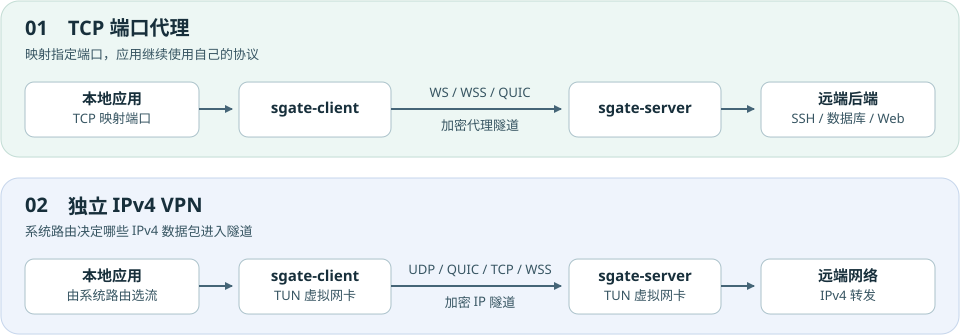
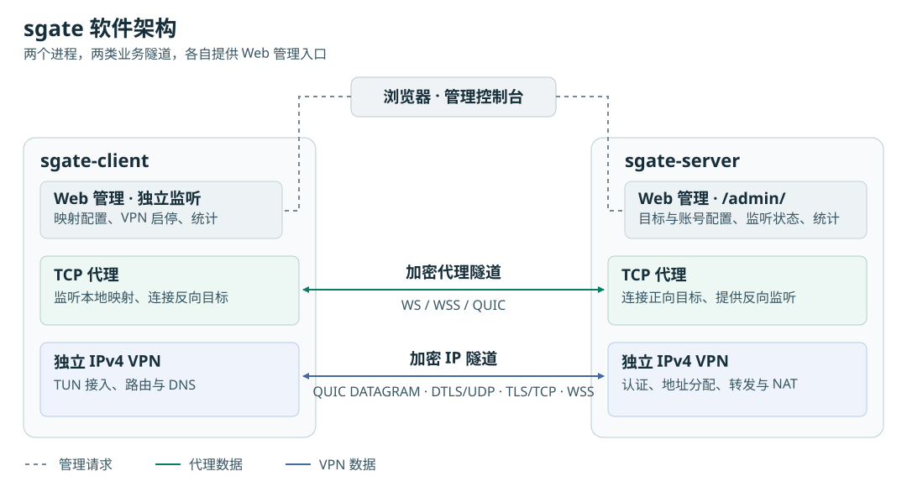
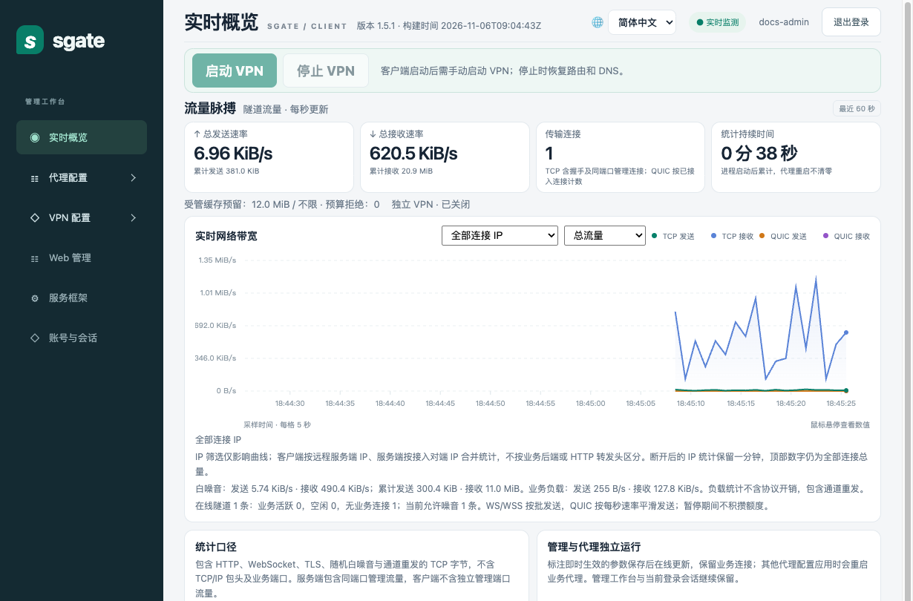
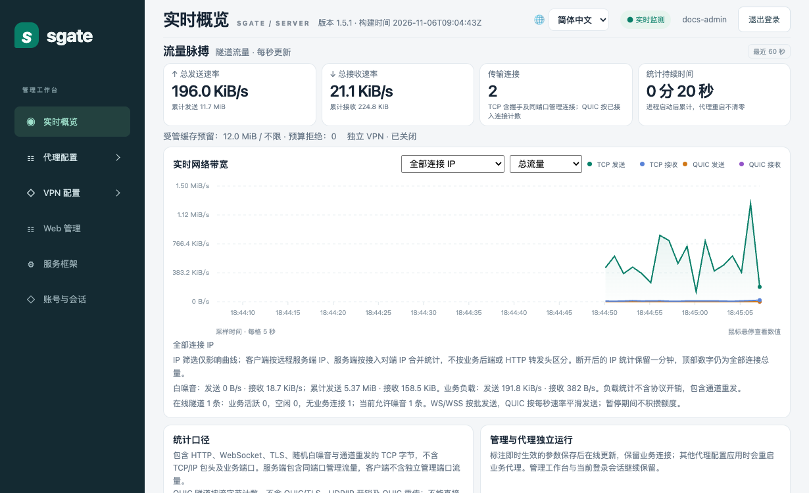
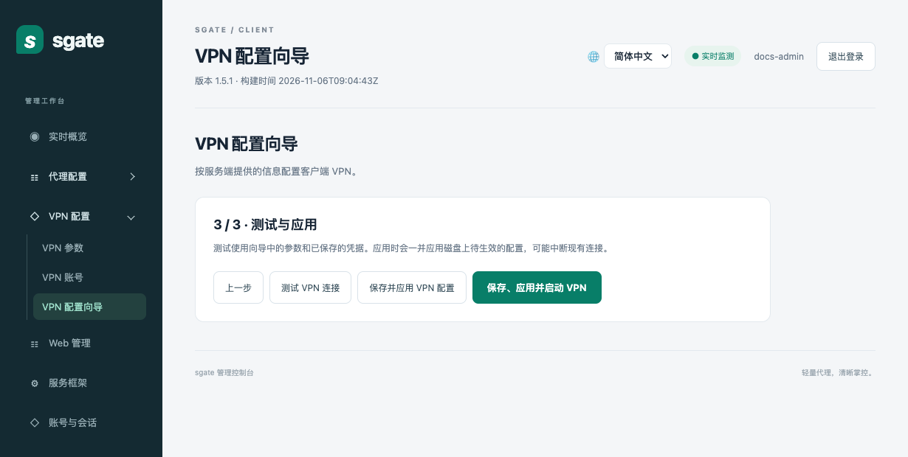

# 从一个端口到一张网，sgate 如何连接两端网络

出门在外，想用 SSH 登录办公室的开发机，只需要一个端口。换个场景，想让浏览器、命令行工具和几个桌面应用都能访问远端网络，逐个配端口就不太方便了。还有一种情况，服务运行在内网里，却需要让远端一侧访问它。

这三种需求都可以用 sgate 解决。它用 `sgate-client` 和 `sgate-server` 两个程序建立加密连接，提供正向 TCP 转发、反向 TCP 转发和独立 IPv4 VPN。两端都带 Web 管理界面，可以配置连接、管理账号、查看实时流量。

## 一、设计思想

sgate 把**按端口转发**和**按路由转发**分开。

端口转发适合目标明确的场景。比如把本机的一个端口映射到远端数据库，应用只要把连接地址改成本地映射地址，仍然使用原来的数据库协议。每增加一个需要访问的服务，就增加一条映射。系统路由无需调整。

独立 VPN 面向的是一段网络。应用照常使用目标 IP，系统路由决定哪些 IPv4 数据包进入虚拟网卡，再由 sgate 送到远端。这样，多个应用可以共享同一条隧道，也可以按网段控制访问范围。

两种方式可以同时运行。比如平时用端口映射访问开发数据库，需要排查远端网络时再启动 VPN。客户端把启停按钮放在实时概览顶部，停用时会清理本次 VPN 设置的路由和 DNS。

*图 1 · 端口代理转发应用的 TCP 连接，VPN 转发系统路由选中的 IPv4 数据包。*

## 二、应用场景

**从本机访问远端服务，用正向 TCP 转发。** 假设测试环境里的 Web 服务只在服务端所在网络内可达。客户端在本机监听 `127.0.0.1:9000`，浏览器打开这个地址，请求就会沿加密隧道到达服务端，再由服务端连接目标。SSH、数据库和其他 TCP 服务也可以各用一条映射。客户端显式指定目标时，该目标必须在服务端允许列表里。

**让远端访问客户端内网，用反向 TCP 转发。** 例如一台演示机藏在办公室路由器后面，远端环境需要访问它。由办公室里的 sgate 客户端主动连接服务器，服务器再提供一个反向监听端口。远端请求到达后，客户端从办公室网络连接演示机。反向监听由服务端配置，客户端也要对相应映射显式授权。

**需要访问多个地址或让多个应用共用连接，用独立 IPv4 VPN。** 例如测试人员要访问一整个测试网段，可以把该网段交给 VPN 路由。服务端在认证后为客户端分配虚拟 IPv4 地址，再按部署环境配置转发和 NAT。启用 VPN 需要相应的系统网络管理权限。

## 三、软件架构

客户端和服务端各自包含三部分。TCP 代理处理应用连接，独立 VPN 处理 IPv4 数据包，Web 管理界面负责配置、启停和观测。浏览器分别访问两端的管理入口。中间两条业务通道可以按需开启，也可以同时运行。

*图 2 · 虚线表示浏览器到两端的管理请求，绿色和蓝色实线分别表示代理和 VPN 的双向数据通道。*

看图时可以从两端的职责入手。正向代理由客户端监听本地端口，由服务端连接目标。反向代理交换这两个角色，由服务端监听，客户端连接它所在网络中的目标。VPN 则由客户端通过 TUN 接入系统路由，服务端负责认证、分配虚拟 IPv4 地址，并按配置转发报文。

在两端代理之间，使用 WS 或 WSS 时，多条业务 TCP 连接可以复用同一条 WebSocket。使用原生 QUIC 时，每条业务 TCP 连接有独立的 QUIC 流，确认、排队和重放也按流维护。代理协议使用 AES-256-GCM 加密。

sgate 将逻辑会话与底层连接分开。网络短暂中断时，只要双方还保留会话状态，并且仍在恢复窗口内，就可以重建传输、重放尚未确认的数据。每条流和每个会话的缓存都有上限，避免慢连接长期积压数据。这个机制针对传输断线，进程重启后需要重新建立业务连接。

VPN 走独立的数据入口，支持 QUIC DATAGRAM、DTLS/UDP、TLS/TCP 和 WSS。QUIC DATAGRAM 与纯 UDP 不重传业务数据包，丢包由内层协议或应用处理。TCP 和 WSS 提供可靠、有序的传输，但遇到丢包时，后续数据可能要等待重传。具体选哪一种，取决于部署网络允许的协议，以及应用对延迟和丢包的敏感程度。

Web 管理界面负责配置、账号和统计。客户端使用独立的管理监听，服务端的管理入口是 `/admin/`。Web 管理员、代理账号和 VPN 账号分别管理，让登录控制台和使用隧道可以采用不同的授权策略。

## 四、实际运行截图

下面两张图来自本机运行的 **sgate 1.5.1**。测试时，客户端通过 TCP 映射反复读取一个本地 HTTP 文件。请求经过服务端到达后端，再沿隧道返回，所以同一批下载在客户端主要表现为**接收**，在服务端主要表现为**发送**。图中的速率是这次演示的实时采样。

*图 3 · 客户端实时概览。页面顶部是 VPN 启停区，下方显示收发速率、累计流量和带宽曲线。*

*图 4 · 服务端实时概览。图表可按连接 IP 和流量类型筛选，便于对照两端观测到的流量。*

配置 VPN 时，可以先打开服务端的 **VPN 配置向导**，依次设置监听参数、VPN 账号，再保存并应用。接着打开客户端向导，填入服务端地址和共享密钥，按需设置可信证书与账号凭据。最后一步可以先测试连接、认证和数据回显，再决定是否应用并启动 VPN。连接测试使用当前填写的参数，不会修改系统路由。

*图 5 · 客户端向导最后一步，可以先测试连接，再应用配置或启动 VPN。*

第一次试用，可以从 [README 的本机转发示例](../README.md#第一次跑通代理) 开始。在同一台机器上启动 HTTP 后端、sgate 服务端和客户端，用 `curl` 访问本地映射端口。看到 `sgate OK`，就跑通了从应用到后端的完整转发路径。随后可以把两端拆到不同机器上，再根据实际需求增加反向映射或启用 VPN。

**项目地址** [GitHub · fly-speed/sgate](https://github.com/fly-speed/sgate)
